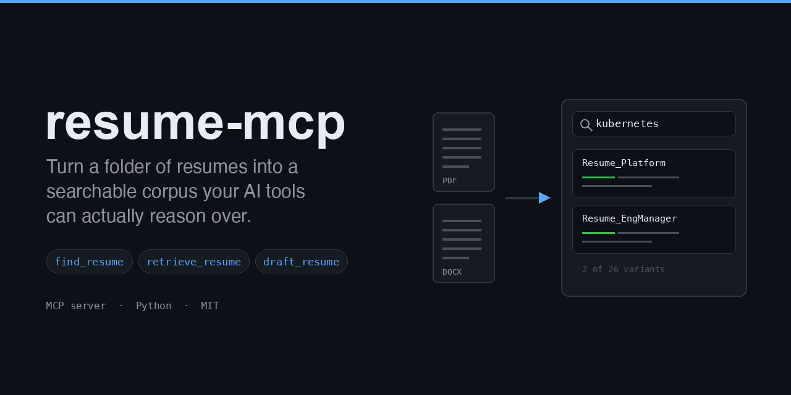

# resume-mcp



An [MCP](https://modelcontextprotocol.io) server that turns a folder of resumes
into a searchable Markdown corpus your AI tools can actually reason over.

Drop a `.pdf` or `.docx` into `source-resumes/`. The server converts it to
Markdown, indexes it, and keeps watching — so your corpus stays current without
you running anything. Then ask your assistant *"which of my resumes mention
Kubernetes?"* or *"pull the variant I sent to that fintech role and compare its
summary to my base one."*

Built for the specific problem of having **many tailored variants** of one
resume and no good way to search across them.

- [Why](#why)
- [Quick start](#quick-start) — install and try it in two minutes
- [Set up your own corpus](#set-up-your-own-corpus)
- [Connect it to your AI tools](#connect-it-to-your-ai-tools)
- [Configuration reference](#configuration-reference)
- [Keeping a base resume current](#keeping-a-base-resume-current) — the curator agent
- [The human in the loop](#the-human-in-the-loop) — how generated output enters the corpus
- [Drafting a resume for one job posting](#drafting-a-resume-for-one-job-posting)
- [Reference](#reference) — tools and commands
- [How it works](#how-it-works)
- [Privacy](#privacy)

## Why

Most people tailoring resumes end up with a graveyard of near-duplicate PDFs.
The content is valuable — every variant has a bullet you phrased well once and
can't find now — but it's locked in binaries your tools can't read.

This makes that history a first-class corpus:

- **Grounded, not invented.** The assistant quotes what you actually wrote.
- **Always current.** A file watcher reconciles on startup and on change.
- **Your data stays local.** The server makes no network calls.

## Quick start

Requires Python 3.10 or newer.

```bash
git clone https://github.com/msmekka/resume-mcp.git
cd resume-mcp
python3 -m venv .venv
source .venv/bin/activate
pip install .
```

Confirm it works against the bundled fictional corpus:

```bash
resume-mcp review --data-dir ./examples/sample-data   # should print "No generated resumes"
resume-mcp --data-dir ./examples/sample-data          # starts the server
```

The second command starts an MCP server on stdio and will sit there waiting for
a client — that's correct behavior. Press Ctrl-C and move on to wiring it into
your AI tool below. See [`examples/sample-data`](examples/sample-data) for what
the sample corpus contains.

> **A note on `pip install -e .`**
>
> Editable installs are the usual choice if you plan to modify the source, but
> on Python 3.14 the editable install did not load correctly in testing: `pip`
> reported success while `import resume_mcp` failed from any directory other
> than the repo root — a confusing failure, because running from the repo root
> appears to work. `pip install .` is used above because it has no such
> problem. If you do edit the source, re-run `pip install .` to pick up your
> changes, or try `uv pip install -e .`, which uses a different mechanism.

## Set up your own corpus

Your resumes live in a **data directory** that is deliberately separate from
this repo, so your personal history never lands in version control.

```bash
mkdir -p ~/resume-corpus/source-resumes
cp ~/Documents/resumes/*.pdf ~/resume-corpus/source-resumes/
resume-mcp --data-dir ~/resume-corpus
```

On startup it converts everything it finds, then watches for changes. The data
directory ends up looking like this:

```
~/resume-corpus/
├── source-resumes/      # you put .pdf / .docx here
├── markdown-resumes/    # the corpus: generated Markdown, one per source
├── config.json          # index: corpus name -> markdown filename
├── curator.json         # optional, see "Keeping a base resume current"
└── base-resumes/        # optional, generated output (NOT part of the corpus)
```

Only `source-resumes/` is yours to manage by hand. The rest the server
maintains.

## Connect it to your AI tools

### Claude Code

```bash
claude mcp add resume -- /absolute/path/to/.venv/bin/resume-mcp \
  --data-dir ~/resume-corpus
```

### Claude Desktop

In `~/Library/Application Support/Claude/claude_desktop_config.json` (macOS) or
`%APPDATA%\Claude\claude_desktop_config.json` (Windows):

```json
{
  "mcpServers": {
    "resume": {
      "command": "/absolute/path/to/.venv/bin/resume-mcp",
      "args": ["--data-dir", "/absolute/path/to/resume-corpus"]
    }
  }
}
```

Use absolute paths for both. The desktop app does not inherit your shell's
`PATH` or your activated virtualenv, so a bare `resume-mcp` will not be found.

### Anything else that speaks MCP

The server runs over stdio. Point any MCP client at the `resume-mcp` command
with a `--data-dir` argument.

## Configuration reference

Everything you can personalize, in one place.

### Where the corpus lives

| Setting | Flag | Env var | Default |
|---|---|---|---|
| Data directory | `--data-dir` | `RESUME_MCP_DATA_DIR` | working directory |
| Server name, as your client displays it | — | `RESUME_MCP_SERVER_NAME` | `Resume Corpus Manager` |
| Skip the live file watcher | `--no-watch` | — | watcher on |

`--data-dir` wins over `RESUME_MCP_DATA_DIR`, which wins over the working
directory. `--no-watch` reconciles once and skips the background observer, for
one-shot contexts like CI or a cron job.

### `curator.json` — the base resume agent

Optional. Lives in your data directory. Only the curator agent reads it.

```json
{
  "target_title": "Engineering Leader",
  "cadence_days": 90,
  "output_dir": "base-resumes",
  "output_name": "base-resume",
  "brag_file": "brag.md"
}
```

| Field | Meaning |
|---|---|
| `target_title` | The role the base resume positions for. Drives what leads and what drops. **Set this yourself — the agent will not guess it.** |
| `cadence_days` | How often to rebuild. Default `90`. |
| `output_dir` | Where generated resumes go. Absolute, or relative to the data directory. Must not be `markdown-resumes/`. |
| `output_name` | Filename stem for the generated resume. |
| `brag_file` | A running log of recent work, relative to the data directory. Optional but see below. |

**Write a `brag.md`.** Without one the agent can only reorganize what your
existing resumes already say. Anything you've done since your last tailored
resume is invisible to it.

### The brag file format

The curator treats this file as **evidence**, on equal footing with a resume you
actually sent an employer. So it needs dates and numbers — not polish.

```markdown
# Brag file

## 2026-10

- Cut deploy lead time for 40 services from 3 days to 20 minutes by replacing
  hand-rolled CI with GitHub Actions. [led]
- Published the model-evaluation rubric internally; 3 teams adopted it. [built]
- Advised two enterprise customers on retrieval evaluation at their request.
  [advised]

## 2026-09

- Grew the platform team from 6 to 9 engineers. [led]
```

Five rules, and they are the whole format:

1. **Group under `## YYYY-MM` headings.** Month granularity is enough. The
   curator uses dates to work out what is new since the last build.
2. **One accomplishment per bullet, past tense, starting with a verb.** This is
   the shape a resume bullet already has, so less gets lost in translation.
3. **Include the number if you know it; omit it if you don't.** Never estimate.
   The agent will not invent a metric, and it will not upgrade a vague claim
   into a quantified one — so an unnumbered entry stays unnumbered.
4. **Tag the scope** — `[led]`, `[built]`, `[advised]`, `[spoke]`, `[shipped]`.
   Optional, but it tells the curator whether something supports a leadership
   title or an IC one, which changes what leads the resume.
5. **Don't polish.** Phrasing is the curator's job. A blunt note with a real
   number beats a well-written sentence without one.

Two things make this worth maintaining:

- **It is the only input the corpus can't provide.** Everything else the curator
  reads is a resume you already wrote, so without this file a refresh can
  reorder your history but never extend it.
- **The curator tells you what to add.** Its report ends with a
  *Dropped for lack of evidence* section listing anything that appeared in the
  last generated resume but has no backing in the corpus or the brag file.
  Those lines are precisely the ones to write up here.

## Keeping a base resume current

The repo ships a [`resume-curator`](.claude/agents/resume-curator.md) agent for
Claude Code. It builds a general-purpose **base resume** for your
`target_title` — "Engineering Leader", "Staff Data Scientist" — by curating the
strongest bullets from across your tailored variants, and refreshes it every
`cadence_days`.

It curates; it does not write fiction. Every line must trace back to something
already in your corpus or your brag file. Where two variants quote the same
achievement with different numbers it reports the conflict instead of picking
one. Its report names the gaps it could not fill rather than writing around
them.

Install the agent where a scheduler can find it:

```bash
mkdir -p ~/.claude/agents
ln -sfn "$PWD/.claude/agents/resume-curator.md" ~/.claude/agents/resume-curator.md
```

Then run it on demand:

```
Use the resume-curator agent to refresh my base resume.
```

Add "now" or "rebuild" to override the cadence and force a fresh build. To run
it on a schedule, see [`examples/scheduling`](examples/scheduling).

## The human in the loop

Generated base resumes are written to `output_dir`, **outside** the indexed
corpus, and are never added to `config.json`.

This is the most important design decision in the project, so it's worth being
explicit about why. `markdown-resumes/` holds *evidence*: documents a person
wrote and sent to real employers. A generated base resume is *derived work*. If
derived work were indexed back in as evidence, every refresh would read the
previous generation as source material, your own phrasing would be
progressively replaced by the model's, and the drift would compound every
quarter with nothing anchoring it.

So the agent reads the previous base resume for exactly two purposes — checking
its age, and reporting what changed — and never to decide what the new one says.

### Promoting a generated resume

Generated output isn't quarantined forever. Sometimes a generated base resume is
genuinely good and you want it treated as evidence later. It just needs a person
to read it first.

```bash
resume-mcp review --data-dir ~/resume-corpus
resume-mcp promote base-resume --data-dir ~/resume-corpus
```

`promote` prints the whole document, states that promoting makes it searchable,
retrievable, and available as source material to future generations, and asks
for confirmation. Only on `y` is it copied into `markdown-resumes/` and indexed.

**It refuses to run without an interactive terminal.** A cron job, a piped
`yes`, and a headless agent are all turned away. The check's only purpose is to
guarantee a person actually read the document, so there is deliberately **no
`--yes` flag** — a bypass would delete the feature. The curator agent is
instructed never to invoke `promote`, and never to reach the same result by
editing `config.json` or copying into `markdown-resumes/` by hand.

It also refuses two unsafe names:

- one already in the corpus, and
- one matching a file in `source-resumes/` — the next reconcile would regenerate
  that Markdown from the binary and silently discard the promoted copy.

## Drafting a resume for one job posting

`draft_resume` exists so an automated job-search agent can produce a tailored
resume without being able to contaminate the corpus. The intended flow:

1. The agent calls `list_available_resumes`, then `find_resume` with phrases
   from the posting, then `retrieve_resume` on the closest variants.
2. It assembles a draft from text that already exists in those variants.
3. It calls `draft_resume`, which writes to `output_dir/jobs/` with a header
   recording the date, the role, and the posting URL.

The draft is **not** indexed, so it is invisible to `list_available_resumes`,
`retrieve_resume`, and `find_resume` — including on the agent's next run. It
becomes evidence only when you `promote` it, which still requires a terminal.

`draft_resume` refuses to write if `output_dir` resolves inside the corpus, and
suffixes rather than overwrites when two drafts share a company, role, and day.

For a step-by-step walkthrough of connecting this to a scheduled Claude Desktop
(Cowork) task — including why the task can't read your files directly but can
call these tools — see [`docs/cowork-integration.md`](docs/cowork-integration.md).
For a local cron/launchd schedule, see [`examples/scheduling`](examples/scheduling).

## Reference

### MCP tools

What your AI client can call.

| Tool | What it does |
|---|---|
| `list_available_resumes` | Lists every variant in the index. |
| `retrieve_resume(resume_name)` | Returns one variant's full Markdown. |
| `find_resume(query_string)` | Whole-word, case-insensitive search across names and content, with matching-line excerpts. |
| `draft_resume(company, role, markdown, job_url)` | Saves a tailored resume draft to `output_dir/jobs/`, outside the corpus. Does not index it. |

`find_resume` matches whole words: `RAG` finds `RAG` and `hybrid RAG` but not
`storage` or `leverage`. Punctuated terms work as written — `C++`, `.NET`,
`CI/CD`. It uses `\W` lookarounds rather than `\b`, because `\b` asserts a word
character on one side and so fails on exactly those terms. If a query matches
only inside longer words, the result says so instead of reporting nothing.

### Commands

What you run in a terminal. All accept `--data-dir`.

| Command | What it does |
|---|---|
| `resume-mcp` | Runs the MCP server. This is what your AI client invokes. |
| `resume-mcp review` | Lists generated base resumes and whether each is in the corpus. Read-only. |
| `resume-mcp promote <name>` | Shows a generated resume and, on your confirmation, adds it to the corpus. Interactive only. |

## How it works

```
source-resumes/*.pdf|docx
        │
        ├── startup: reconcile_corpus()  — converts anything missing or stale
        │
        └── running: watchdog observer
                 │
                 └── 2s debounce per path
                          │
                          ▼
                    markitdown.convert()
                          │
                          ▼
            markdown-resumes/*.md  +  config.json
```

Two details worth knowing:

- **Debounce.** Word and Pages write a file in bursts, and Pages saves by
  writing a temp file and renaming it into place. Events are coalesced per path
  with a 2-second timer, so a document is converted once it stops changing
  rather than while it's half-written.
- **Stale-only reconcile.** On startup a source is reconverted only if its
  Markdown is missing or older than the source. Hand-edits you make directly to
  files in `markdown-resumes/` survive a restart.

### Supported formats

`.pdf` and `.docx`, via [markitdown](https://github.com/microsoft/markitdown).

Apple Pages (`.pages`) is **not** supported — it's a zip bundle, not a document.
Export to DOCX (see below) or PDF first.

### Text extraction quality

Resumes exported from Apple Pages, and from some other producers, embed fonts
that a PDF text extractor can mis-decode wholesale — yielding text like:

```
plaGorm   automaKon   soRware   integraKon   Innova=on   execuFve   Pla,orm
```

The document itself is fine. It renders correctly and its text layer is
correct; only the extractor is wrong. That distinction matters, because it is
the *text layer* an applicant tracking system reads — so a PDF that extracts
badly in one tool may still be perfectly readable to an employer.

This server extracts PDFs with [pypdfium2](https://github.com/pypdfium2-team/pypdfium2)
rather than markitdown's PDF path. Measured across five Pages-exported resumes:
**130–149 artifacts via markitdown, 17–23 via pypdfium2**, and the pypdfium2
remainder were product names like `TypeScript` and `CloudWatch`, not damage. DOCX stays on
markitdown, which is accurate there and adds real emphasis and links.

Two other repairs are applied, both deterministic:

- **Ligature characters** that carry a real Unicode mapping are expanded.
  `U+FB01` is `fi` and nothing else.
- **`U+FFFE`**, a permanent non-character some of these PDFs carry where a
  hyphen was broken across a line (`self<FFFE>paced`), becomes `-`. An invalid
  code point has no valid reading to preserve.

On a real 26-file corpus this took the artifact count from 241 to 0.

`resume-mcp review` reports a per-file count, so you can check any document you
add.

#### What is deliberately not repaired

Where a *different* extractor still yields substitute characters, it is
tempting to infer the substitution table per document and undo it. That was
implemented and removed. There is no reliable key, and a wrong guess silently
rewrites someone's resume — in testing, inference scored against a vocabulary
built from the corpus itself still turned an email address into
`nametiexample.com` and `Na>ve` into `Natfve`.

A resume is a factual claim its owner will be asked about in an interview, so
quiet corruption is worse than visible damage. The server fixes what has one
correct answer and reports the rest.

### Prefer DOCX when you have both

When `name.docx` and `name.pdf` are both present, the DOCX is converted and the
PDF skipped. This is now a question of structure rather than correctness —
DOCX conversion preserves emphasis and links that raw PDF text extraction
cannot. Keep both on disk; only one is converted.

## Privacy

Your resume corpus is personal data: full name, address, phone, employers,
dates. This project is built so that data stays out of git. `.gitignore`
excludes `source-resumes/`, `markdown-resumes/`, `base-resumes/`, `config.json`,
`curator.json`, and every `.pdf`/`.docx`/`.pages` in the tree. Keeping your data
directory outside the repo entirely, as the setup above does, is safer still.

The server reads and writes only your local filesystem and makes no network
calls. What your *AI client* does with the text it retrieves is governed by that
client's own privacy terms.

## License

MIT — see [LICENSE](LICENSE).
